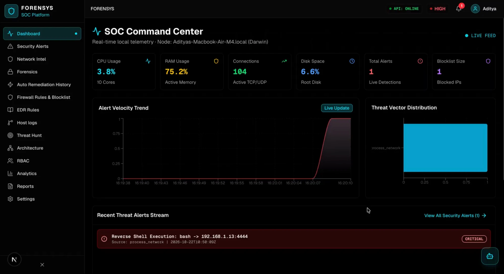
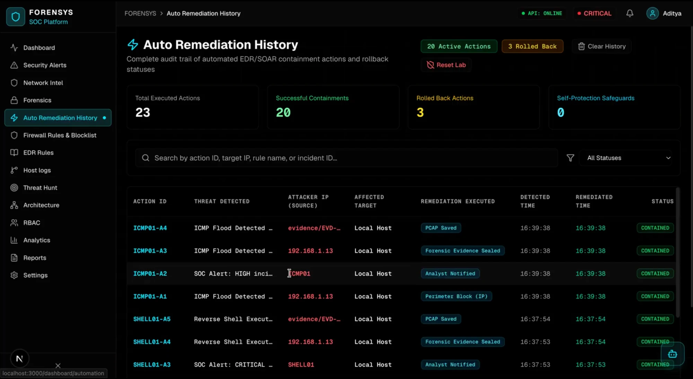
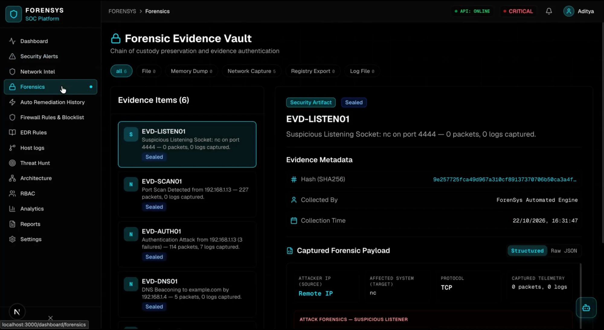
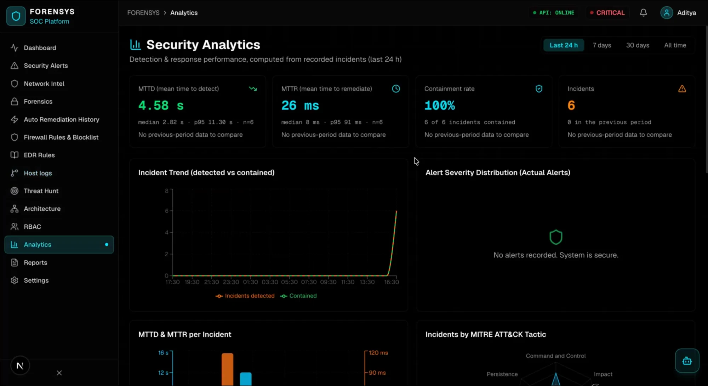
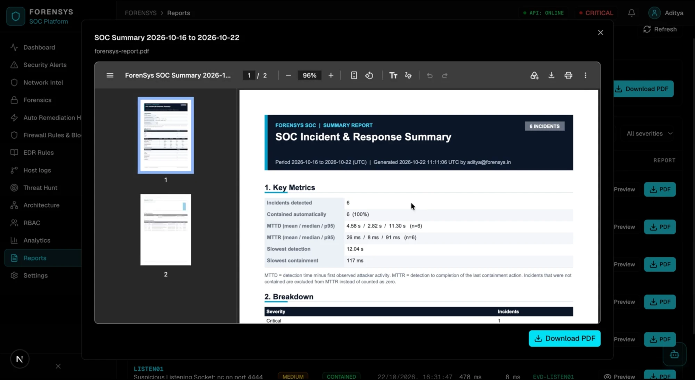
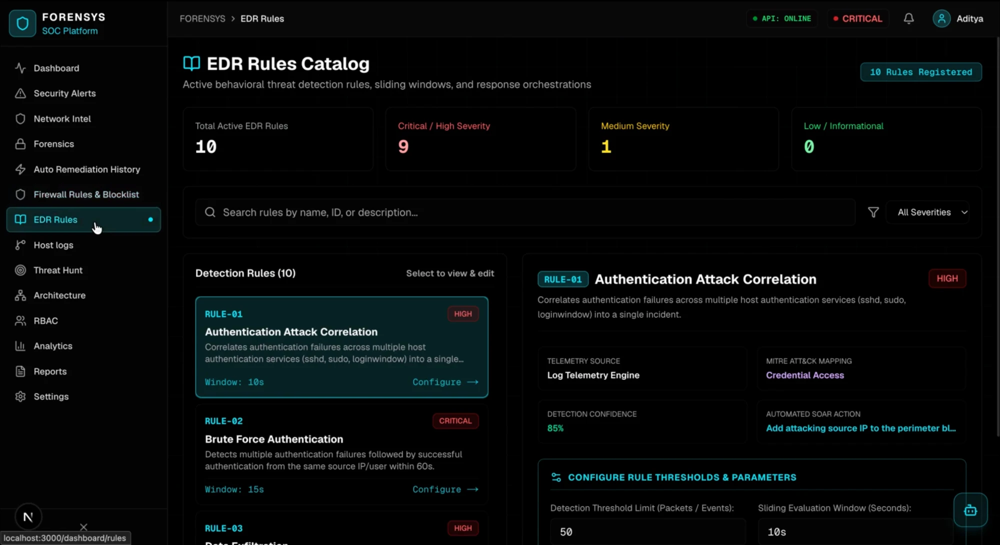
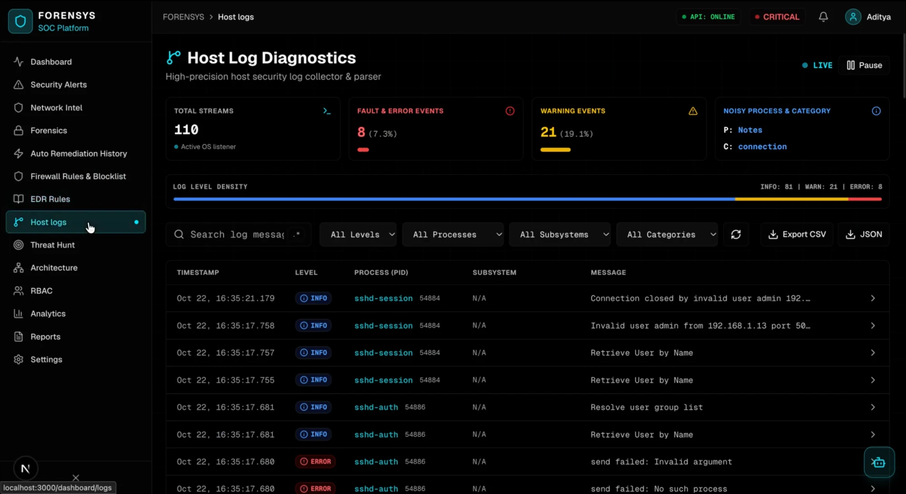
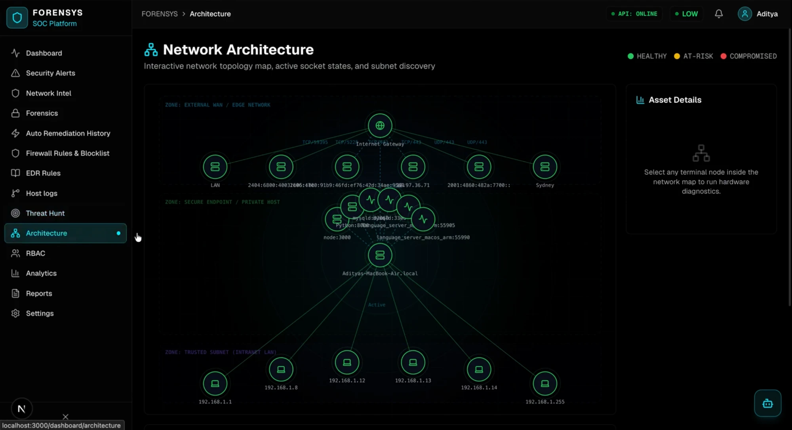
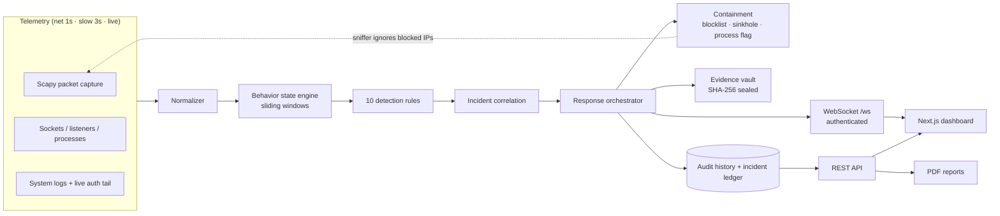

<h1 align="center">ForenSys</h1>

<p align="center">
  <strong>Forensic-Safe Endpoint Detection &amp; Automated SOC Response Platform</strong>
</p>

<p align="center">
  ForenSys watches real telemetry on a single host (packets, sockets, processes, logs), detects attacks with a stateful rule engine,
  raises correlated incidents, contains them with <em>logical</em> auto-remediation, seals forensic evidence, and gives
  analysts a live dashboard, accurate MTTD/MTTR analytics and downloadable PDF incident reports.
</p>

<p align="center">
  <a href="#screenshots">Screenshots</a> ·
  <a href="#features">Features</a> ·
  <a href="#how-it-works">How it works</a> ·
  <a href="#quick-start">Quick start</a> ·
  <a href="#configuration">Configuration</a> ·
  <a href="#detection-rules">Detection rules</a> ·
  <a href="#dashboard">Dashboard</a> ·
  <a href="#reports--analytics">Reports &amp; analytics</a> ·
  <a href="#real-attack-demos">Real attack demos</a> ·
  <a href="#testing">Testing</a> ·
  <a href="#project-structure">Project structure</a> ·
  <a href="#troubleshooting">Troubleshooting</a> ·
  <a href="#limitations">Limitations</a>
</p>

> **Containment is logical only.** ForenSys never edits the OS firewall, signals processes or changes files. A "block" adds the address to a perimeter blocklist that the packet sniffer ignores until an analyst manually unblocks it. See [Security](#security) and [SECURITY.md](SECURITY.md).

---

## Screenshots

<p align="center">
  <br>
  <sub><b>SOC Command Center</b> - live host telemetry, alert velocity and the real-time threat stream (a reverse shell caught on a real two-laptop test).</sub>
</p>

<table>
  <tr>
    <td width="50%" valign="top">
      <br>
      <sub><b>Auto Remediation History</b> - every containment action: perimeter block, evidence sealed, PCAP saved, analyst notified.</sub>
    </td>
    <td width="50%" valign="top">
      <br>
      <sub><b>Forensic Evidence Vault</b> - per-incident packages sealed with a SHA-256 hash and a chain of custody.</sub>
    </td>
  </tr>
  <tr>
    <td width="50%" valign="top">
      <br>
      <sub><b>Security Analytics</b> - MTTD / MTTR (mean, median, p95) computed from real incident timestamps.</sub>
    </td>
    <td width="50%" valign="top">
      <br>
      <sub><b>Reports</b> - downloadable PDF incident reports and a date-range SOC summary.</sub>
    </td>
  </tr>
  <tr>
    <td width="50%" valign="top">
      <br>
      <sub><b>EDR Rules Catalog</b> - 10 detection rules with MITRE mapping, confidence and live thresholds.</sub>
    </td>
    <td width="50%" valign="top">
      <br>
      <sub><b>Host Log Diagnostics</b> - live OS log stream including the SSH authentication events used for detection.</sub>
    </td>
  </tr>
</table>

<p align="center">
  <br>
  <sub><b>Network Architecture</b> - interactive topology of the host, its sockets and the discovered LAN.</sub>
</p>

---

## Features

| Area | What you get |
|---|---|
| **Detection** | 10 stateful, threshold-based rules (scans, floods, brute force, C2 beaconing, reverse shells, exfiltration, rogue listeners, suspicious process chains) mapped to MITRE ATT&CK. Each attack is reported once per *episode*, not once per second. |
| **Correlation** | Alerts sharing an entity (attacker IP, process) merge into one incident (`SCAN01`, `AUTH01`, `EXFIL01`, ...) with risk score, confidence and kill-chain stages. |
| **Response** | One workflow for every detection: *detect → incident → contain → seal evidence → log history*. Containment = IP blocklist, DNS sinkhole or process flag, with one-click rollback and manual re-block. |
| **Forensics** | Per-incident sealed package: attack-specific facts (e.g. every probed port), packets, logs, sockets, a headers-only `capture.pcap` and `evidence.json`, protected by a SHA-256 digest that is re-verified whenever it is reported. |
| **Analytics** | MTTD and MTTR per incident from real timestamps (mean / median / p95), containment rate, trends, MITRE breakdown, per-attack-type response table. |
| **Reports** | Full PDF per incident and a date-range SOC summary PDF, generated server-side with no extra dependency. |
| **Live telemetry** | Real-time packet capture (Scapy/BPF), sockets with process mapping, geolocated peers, system logs, a live `sshd`/`sudo` log tail and ARP devices. |
| **Self-protection** | ForenSys never alerts on or contains itself, its dependencies (`mysqld`, the Python backend, the Next.js dev server) or stock macOS services (`cupsd`, AirPlay, `rapportd`, `sharingd`), always matched by process *and* port. |
| **Access control** | JWT sessions (bcrypt passwords), four roles / twelve permissions, authenticated WebSocket, restricted CORS. |
| **Iris copilot** | Sidebar assistant grounded in live data (alerts, incidents, MTTD/MTTR, blocklist, remediation, evidence). Uses Gemini when `GEMINI_API_KEY` is set, otherwise answers locally from the same data; it never invents hosts, IPs or numbers. |

---

## How it works



- **Two-speed collection.** Sockets, listeners and new processes are polled every second, system metrics/logs/ARP every three, and `sshd`/`sudo` lines stream live. Blocking collectors run in worker threads, so detection stays fast.
- **Real timestamps.** Packets keep the time they were captured, which is what makes MTTD meaningful.
- **Blocklist feedback loop.** Once an IP is blocked the sniffer drops its traffic and the state engine forgets its events, so stale data cannot re-trigger a rule. Unblocking re-arms detection.

---

## Quick start

### Prerequisites

| Requirement | Notes |
|---|---|
| Node.js **20.9+** and npm | Next.js 16 / React 19 |
| Python **3.10+** with `venv` | Backend (FastAPI) |
| MySQL or MariaDB | Stores user accounts (default `127.0.0.1:3306`) |
| macOS or Linux | macOS is the primary target (`log stream`, `lsof`); Linux uses `tail -F /var/log/auth.log` |
| `sudo` access *(optional)* | Only for real packet capture (BPF). Without it ForenSys runs on simulated traffic |

### Install

```bash
git clone https://github.com/Ad1tya244/ForenSys.git
cd ForenSys

# Frontend
npm install

# Backend
python3 -m venv backend/.venv
backend/.venv/bin/python -m pip install -r backend/requirements.txt
```

### Configure and initialise

Create `backend/.env` (see [Configuration](#configuration)), then create the database and `users` table:

```bash
backend/.venv/bin/python backend/init_db.py
```

### Run

```bash
npm run dev              # frontend :3000 + backend :8000, simulated traffic only
npm run dev:privileged   # backend under sudo: REAL packet capture (needed to detect real attacks)
```

Open <http://localhost:3000/login>. On the first run the login page offers **initial setup** - create your administrator account there, **before** exposing the backend to a network (see [SECURITY.md](SECURITY.md)).

Check the capture mode at any time: `curl -s localhost:8000/api/health` → `"capture_mode": "live"` means real BPF capture, `"simulated"` means real attacks from other machines will **not** be visible.

---

## Configuration

### Backend - `backend/.env`

| Variable | Purpose | Default |
|---|---|---|
| `MYSQL_HOST` / `MYSQL_PORT` | Database server | `127.0.0.1` / `3306` |
| `MYSQL_USER` / `MYSQL_PASSWORD` | Database credentials | `root` / *(empty)* |
| `MYSQL_DB` | Database name | `forensys` |
| `JWT_SECRET_KEY` | Token signing secret | **Auto-generated** into this file on first start if missing or weak |

### Frontend - `.env.local`

| Variable | Purpose | Default |
|---|---|---|
| `NEXT_PUBLIC_BACKEND_URL` | Backend base URL | `http://<current host>:8000` |
| `GEMINI_API_KEY` | Enables the Gemini-powered Iris copilot (server-side only) | unset → local fallback |

### Detection thresholds - `backend/config.json`

Editable on disk or live from the **EDR Rules** page (editing is offered to admins in the UI; the API requires `manage_playbooks`). Key settings:

| Key | Default | Meaning |
|---|---|---|
| `icmp_threshold` / `icmp_window_sec` | 50 / 10 | ICMP echo requests per source |
| `portscan_threshold` / `portscan_window_sec` | 20 / 15 | Distinct ports probed per source |
| `syn_threshold` / `syn_window_sec` / `syn_flood_max_ports` | 50 / 10 / 5 | SYNs concentrated on few ports |
| `auth_failure_limit` / `auth_window_sec` | 3 / 60 | Failed logins per source |
| `auth_service_syn_threshold` | 15 | New connections to a login service per source |
| `dns_beacon_min_queries` / `dns_beacon_max_variance` | 5 / 0.2 | Periodic lookups of one domain |
| `data_exfiltration_bytes` / `_window_sec` / `_upload_ratio` | 100 MB / 20 / 0.75 | Upload volume and share of outbound traffic |
| `exfil_monitor_private_dst` | `false` | Also flag large uploads to LAN hosts |
| `auto_remediation_enabled` | `true` | Run the containment workflow automatically |

### Runtime state (git-ignored, in `backend/`)

`remediation_history.json` (audit log) · `perimeter_registry.json` (active blocks) · `incident_ledger.json` (MTTD/MTTR) · `evidence_vault.json` and `evidence/<EVD-ID>/` (sealed packages, pcap, JSON) · `rules.json`, `settings.json`, `users.json` (fallback)

---

## Detection rules

| Rule | Triggers when | Containment |
|---|---|---|
| **ICMP Flood** | ≥ 50 echo requests from one remote IP in 10 s | Block source IP |
| **Port Scan** | ≥ 20 distinct ports probed (bare TCP SYN) in 15 s | Block source IP |
| **SYN Flood** | ≥ 50 SYNs in 10 s concentrated on ≤ 5 ports | Block source IP |
| **Brute Force Authentication** | ≥ 3 failed logins then a success from one source in 60 s (unit-tested; not triggerable live, see the demo runbook) | Block source IP |
| **Authentication Attack** | ≥ 3 failed logins (separate connections) per remote IP in 60 s, or ≥ 15 new connections to SSH/FTP/Telnet/SMB/RDP/VNC | Block source IP |
| **DNS Beaconing** | ≥ 5 regular lookups of one domain (low variance) in 60 s | Sinkhole domain |
| **Reverse Shell** | A shell/interpreter opens an outbound connection to an uncommon external port | Block C2 IP + flag process |
| **Data Exfiltration** | ≥ 100 MB uploaded to one external peer in 20 s and ≥ 75 % of its traffic is outbound (downloads never count) | Block destination IP |
| **Suspicious Listening Port** | `nc`/`ncat`/`socat`/shell-class process opens a listener | Flag process |
| **Suspicious Process Chain** | Configured parent→child pairs (e.g. Word → bash) | Flag process |

A port scan and a SYN flood are mutually exclusive by design, so a single `nmap -sS` is reported once.

---

## Dashboard

| Page | Purpose |
|---|---|
| **Dashboard** | Live host metrics, threat level, alert stream, self-protection audit |
| **Security Alerts** | Alerts and correlated incidents; acknowledge, resolve, escalate |
| **Network Intel** | Connections, geolocation, blocklist hits, regex search, CSV/JSON export |
| **Forensics** | Sealed evidence packages with structured attack details; **Incident Report (PDF)** |
| **Auto Remediation History** | Audit trail with rollback. **Clear History** clears only the log; **Reset Lab** (confirmation required) wipes alerts, incidents, evidence, the analytics ledger and all containment |
| **Firewall Rules & Blocklist** | Perimeter blocklist: block, unblock and re-block IPs (released IPs stay listed) |
| **EDR Rules** | Rule catalog and live threshold editing (admin) |
| **Host Logs / Threat Hunt / Architecture** | Log explorer, hunting queries, topology map |
| **Analytics** | MTTD/MTTR and response performance (24 h / 7 d / 30 d / all) |
| **Reports** | Per-incident and summary PDFs |
| **RBAC / Settings** | Users, roles, permissions, preferences |

### Roles and permissions

| Role | Permissions |
|---|---|
| **admin** | All 12: `view_alerts`, `manage_alerts`, `view_incidents`, `manage_incidents`, `view_forensics`, `export_forensics`, `view_analytics`, `run_hunt`, `manage_playbooks`, `view_logs`, `manage_settings`, `manage_users` |
| **analyst** | `view_alerts`, `manage_alerts`, `view_incidents`, `manage_incidents`, `view_forensics`, `view_analytics`, `run_hunt`, `view_logs` |
| **responder** | `view_alerts`, `manage_alerts`, `view_incidents`, `manage_incidents`, `manage_playbooks`, `view_logs` |
| **viewer** | `view_alerts`, `view_incidents`, `view_analytics`, `view_logs` |

---

## Reports & analytics

**Definitions** (per incident, backend wall clock):

- **MTTD** = detection time − first observed attacker activity. It includes the time an attack needs to cross its rule's threshold.
- **MTTR** = detection → completion of the last containment action. Evidence sealing is excluded.
- Incidents that were never contained have **no MTTR** and are excluded rather than counted as zero. Period-over-period changes appear only when both periods have data.

**Incident PDF** contents: executive summary · timeline · detections · attack forensics · containment actions · evidence and live integrity check (flags tampering) · packets · log evidence · host context · recommended follow-up.

**Endpoints** (authenticated): `GET /api/incidents/{id}/report.pdf` (`view_forensics`), `GET /api/reports/summary.pdf?start=&end=` (`view_analytics`), `GET /api/analytics/response-metrics?range=` (`view_analytics`), `GET /api/incidents/ledger` (`view_incidents`).

---

## Real attack demos

ForenSys is demonstrated with **real traffic from a second machine you own**, not an in-app simulator. Start with `npm run dev:privileged`, then follow [docs/REAL_ATTACK_DEMOS.md](docs/REAL_ATTACK_DEMOS.md): nmap port scan, ICMP/SYN flood, SSH failed logins, DNS beaconing, reverse shell and rogue listener (all verified live), plus exfiltration and the process chain (unit-tested; see the status table in the runbook). Afterwards open **Reports** for the PDF and **Analytics** for MTTD/MTTR.

> Only test against systems and networks you own or are explicitly authorised to test.

An offline end-to-end pipeline check is also available: `backend/.venv/bin/python backend/scripts/simulate_attacks.py`.

---

## Security

Key properties (full policy, threat model and known limitations in [SECURITY.md](SECURITY.md)):

- Passwords hashed with bcrypt; 15-minute JWT access tokens plus an `HttpOnly` refresh cookie; no default signing secret (one is generated per install).
- The live `/ws` stream requires an access token sent as the first message (never in the URL) and stops when the token expires.
- Every mutating or evidence-bearing REST endpoint enforces an RBAC permission; CORS allows only localhost / private-LAN origins.
- Evidence packages are SHA-256 sealed and re-verified on every report.
- No shell execution of untrusted input; remediation never touches the OS firewall or processes.

To report a vulnerability, follow [SECURITY.md](SECURITY.md) - please do not open a public issue for it.

---

## Testing

```bash
cd backend
.venv/bin/python -m unittest discover -s tests -p "test_*.py" -t .
```

Covers the full detect → contain → evidence → history workflow for every rule, self-protection and trusted-dependency filtering, containment registry semantics (clear log vs reset), MTTD/MTTR correctness and statistics, ledger persistence, PDF validity and content, and security regressions (WebSocket auth, token expiry, CORS policy, JWT secret). Tests run against temporary files and never touch your runtime data. Type-check the frontend with `npx tsc --noEmit`.

---

## Project structure

```text
├── app/                       Next.js App Router (dashboard pages, login, /api/chat)
├── components/                UI components (shadcn/ui, RBAC guards, Iris sidebar)
├── lib/                       api-client.ts (REST/WebSocket), app-store.ts (Zustand), copilot-store.ts + copilot-context.ts (Iris), format.ts
├── scripts/start-dev.js       Launcher: backend first, then Next.js (sudo for the backend only with --privileged)
├── docs/REAL_ATTACK_DEMOS.md  Two-machine attack runbook
├── docs/screenshots/          Images used in this README
├── backend/
│   ├── main.py                FastAPI app, auth/RBAC, loops, REST + WebSocket
│   ├── collectors/            traffic (Scapy), network, processes, system, logs (+ live auth tail)
│   ├── analyzers/             IP intelligence, legacy heuristic detector
│   ├── pipeline/              normalizer, state engine, rules/, correlation, soar_engine, evidence,
│   │                          response (orchestrator), metrics (ledger + MTTD/MTTR), self_protection
│   ├── reporting/             Dependency-free PDF writer, incident + summary report builders
│   ├── scripts/               simulate_attacks.py (offline pipeline check)
│   └── tests/                 Unit and integration tests
├── CLAUDE.md                  Conventions and invariants for AI-assisted development
├── SECURITY.md                Security policy, model and known limitations
└── forensys.md                Extended project write-up (architecture, challenges, FAQ)
```

---

## Troubleshooting

| Symptom | Cause / fix |
|---|---|
| Real attacks are not detected | Backend is in simulated mode. Use `npm run dev:privileged` and confirm `capture_mode` is `live` in `/api/health` |
| `Failed to open database ... invalid digit found in string` from `next dev` | The project sits in a cloud-synced folder (iCloud Drive, Dropbox, ...) which duplicates Turbopack's cache files. The repo already disables that cache (`experimental.turbopackFileSystemCacheForDev: false`); delete `.next` once and restart |
| Browser shows a 404 | The URL is not a ForenSys route (e.g. restored from another project). Open `/login` or `/dashboard` |
| Everyone was logged out | A new `JWT_SECRET_KEY` was generated (first start, or you removed it). Sign in again |
| SSH brute force not seen from logs | Enable *Remote Login* on the target; the network-level heuristic still catches connection storms |
| Login or setup fails | MySQL is unreachable or `init_db.py` was not run |

---

## Limitations

- Single-host, local-first design; not a production multi-endpoint EDR.
- Containment is logical (blocklist/sinkhole/flag) by design and does not stop traffic at the OS level.
- Detection is heuristic and threshold-based; thresholds suit a lab or workstation and should be tuned.
- Live auth-log detection and `lsof` fallbacks are macOS-first; Linux support is partial.
- Iris answers only from the snapshot the browser sends (latest 20 alerts, 15 incidents, 20 remediation actions); with a Gemini key that snapshot leaves the machine (see [SECURITY.md](SECURITY.md)). `/api/chat` does not yet verify the session.
- PDF reports use built-in fonts (Latin-1 text); other scripts are replaced with `?`.
- See [SECURITY.md](SECURITY.md) for security-related limitations.

---

## Contributing

Issues and pull requests are welcome. Please run the test suite and `npx tsc --noEmit` first, and keep to the project invariants in [CLAUDE.md](CLAUDE.md) - most importantly, remediation must stay logical (no firewall or process manipulation). Report vulnerabilities privately as described in [SECURITY.md](SECURITY.md).

## License

This project is for security analysis, EDR/XDR engineering and SOC portfolio purposes. No open-source license has been attached yet, so all rights are reserved by the author unless stated otherwise.
